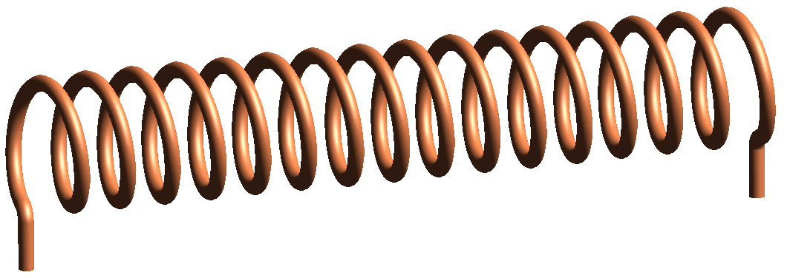
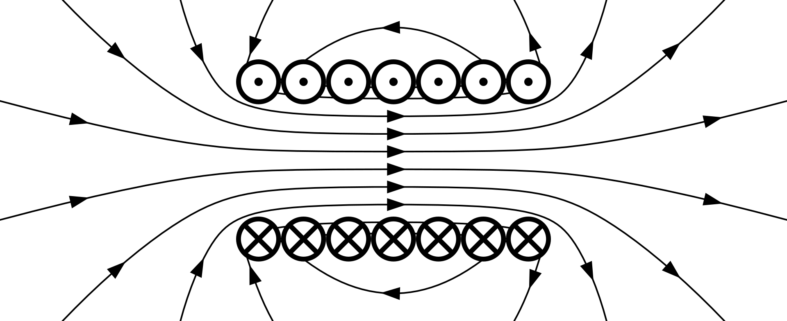
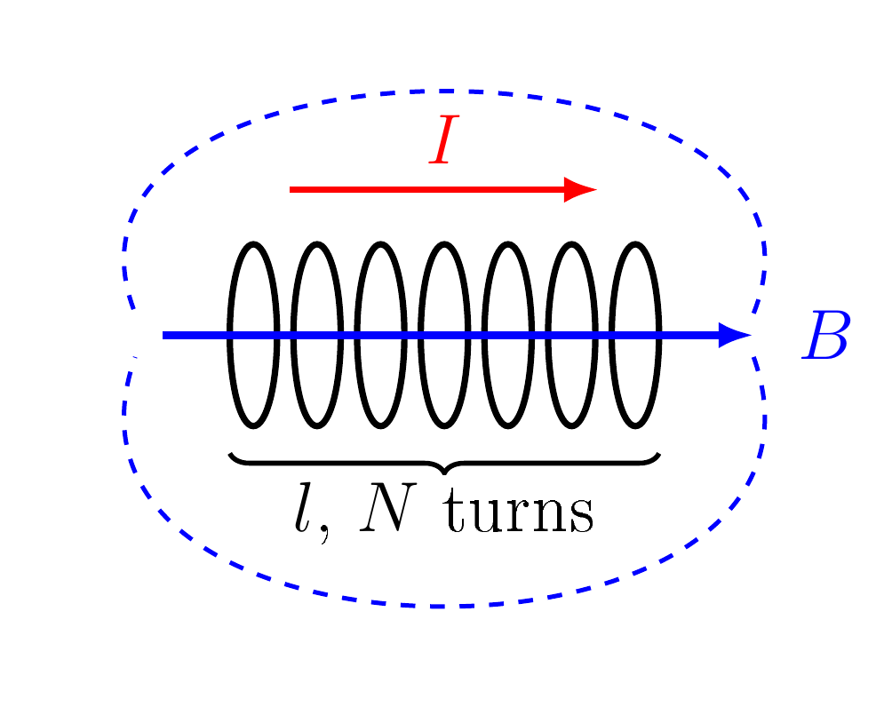
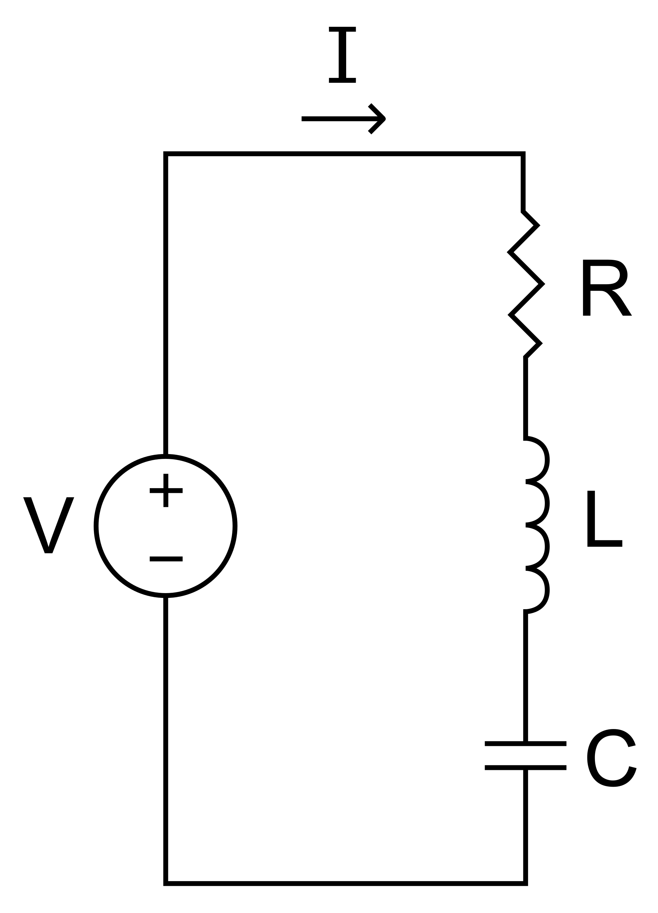
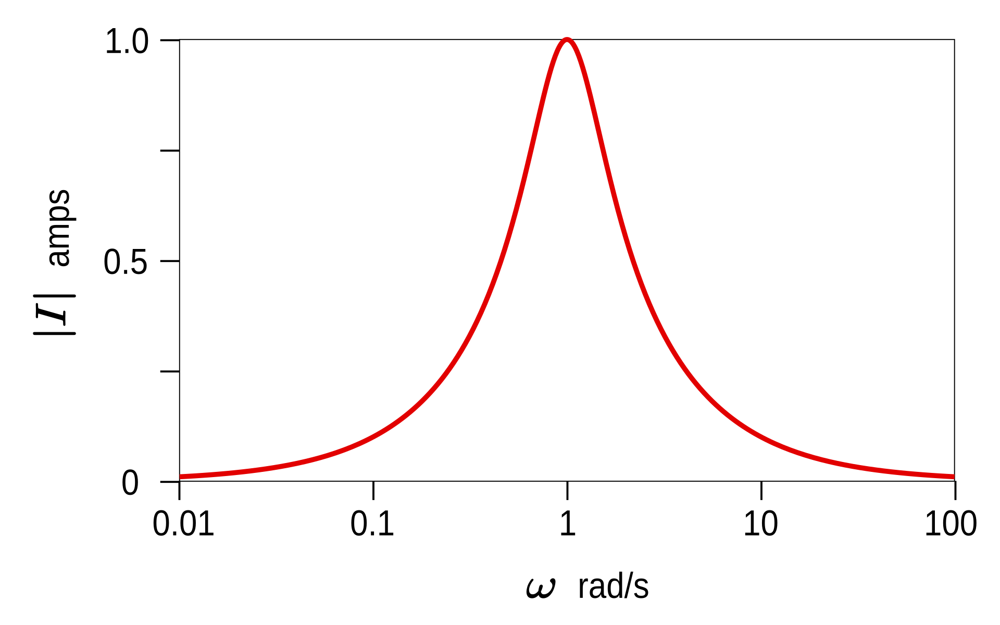
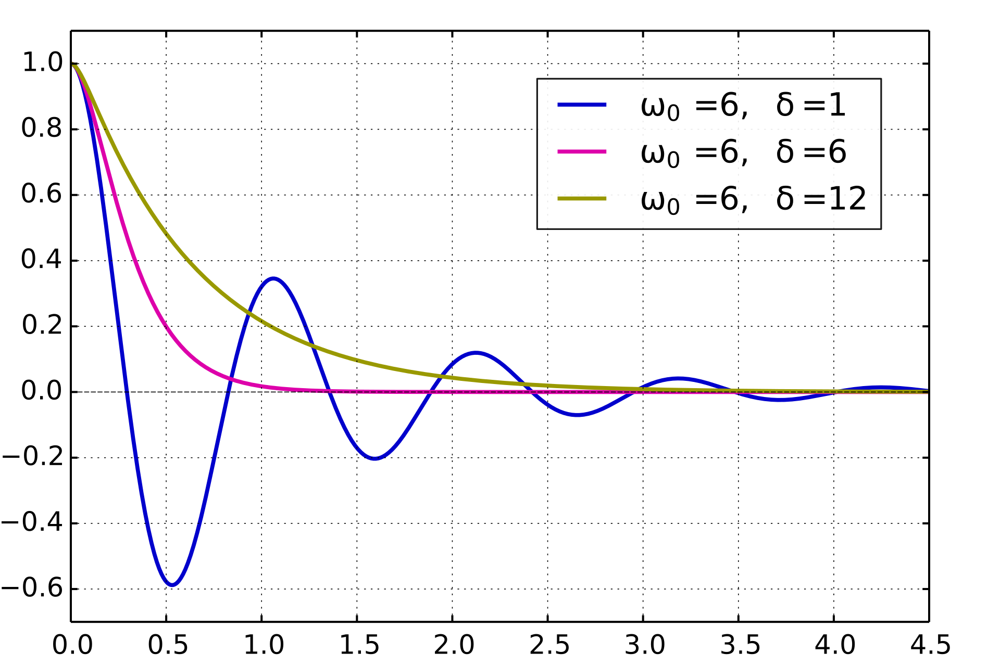
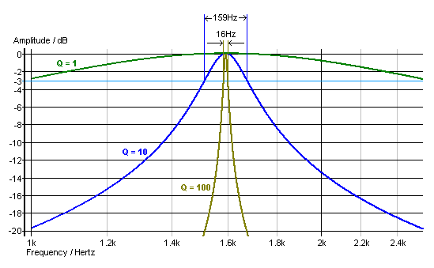

# The Solenoid

_What it is · Magnetic field · Inductance · Induction · Uses_  (palette: classic)

## What is a solenoid?

A solenoid is a wire wound in a tight helix, a coil whose length is much greater than its diameter.

- Each turn makes a small loop field, and the loops add up inside.
- Inside: a strong, uniform field along the axis.
- Outside: a weak field, like a bar magnet with N and S ends.

$$\oint \mathbf{B}\cdot d\mathbf{l}=\mu_0 I_{\mathrm{enc}}$$

$$\Rightarrow\ Bl=\mu_0 N I$$
- Ienc: current through the loop, NI
- l: length of the coil (m)

  _Wikimedia Commons_

## Magnetic field

A current through the coil makes a nearly uniform field inside. The right-hand grip rule gives its direction.

- Iron core: B rises by μeff.
- B does not depend on r.

$$B=\mu_0\,\frac{N}{l}\,I$$
- B: field inside (T)
- μ0: 4π × 10−7 H/m

**Example**

- N = 500, l = 0.25 m, I = 2 A
- B = 5.0 mT

  _Wikimedia Commons_

## Inductance & induction

The coil links its own flux, so it has an inductance. A changing field through it induces a voltage.

- L ∝ N2: double the turns, 4L.
- Energy W = ½LI2.

$$L=\frac{\mu_0 N^2 A}{l}$$

$$e=-NA\,\frac{dB}{dt}$$
- A: area (m2)
- e: induced emf (V)

**Example**

- Same coil, r = 2 cm
- L = 1.58 mH

  __

## Uses

The same coil sends a field (transmitter) and senses one (receiver).

- Relays, valves, locks.
- MRI and ITER magnets.

$$m=NIA$$
- m: magnetic moment (A m2)

**In EM surveys**

- Tx: large m.
- Rx: e ∝ NA dB/dt.

  _Wikimedia Commons_

---

# The Series RLC Circuit

_What it is · Resonance · Damping · Bandwidth · Q factor_  (palette: ocean-tint)

## What is an RLC circuit?

An RLC circuit is a resistor R, an inductor L and a capacitor C connected to a voltage source.

- R loses energy as heat.
- L stores energy in a magnetic field, C in an electric field.
- Energy swaps between L and C, so the circuit oscillates.

$$L\frac{dI}{dt}+RI+\frac{q}{C}=V(t)$$
- q: capacitor charge, I = dq/dt
- ω0: 1/√(LC), natural frequency

  _Wikimedia Commons_

## Resonance

At ω0 the reactances of L and C cancel, so the circuit resonates.

- V and I in phase.
- VL = VC = QV.

$$\omega_0=\frac{1}{\sqrt{LC}}$$
- f0: ω0/2π (Hz)

**Uses**

- Radio tuning.
- Tuned EM loops.

  _Wikimedia Commons_

## Damping

R removes energy, so free oscillations die away.

- ζ < 1: rings.
- ζ = 1: critical.

$$\zeta=\frac{R}{2}\sqrt{\frac{C}{L}}$$
- ζ: damping ratio

**Uses**

- Car suspension.
- Damped TEM coils.

  _Wikimedia Commons_

## Bandwidth & Q

The bandwidth is the peak width at half power.

- High Q: narrow peak.
- Low Q: broad, fast.

$$Q=\frac{f_0}{\Delta f}$$
- Q: 1/(2ζ)

**Example**

- L = 10 mH, C = 1 μF
- R = 10 Ω: Q = 10

  _Wikimedia Commons_

---
